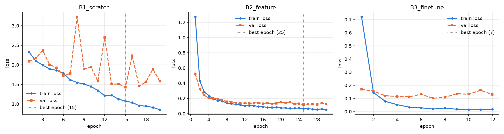
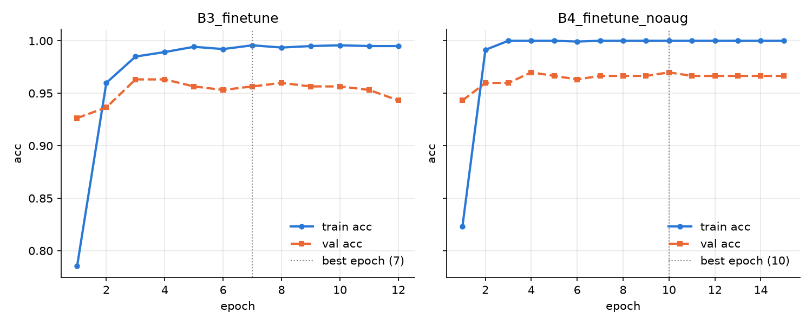
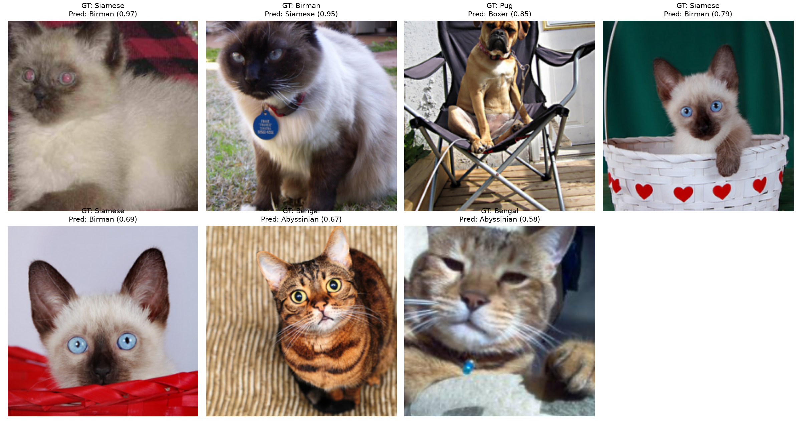
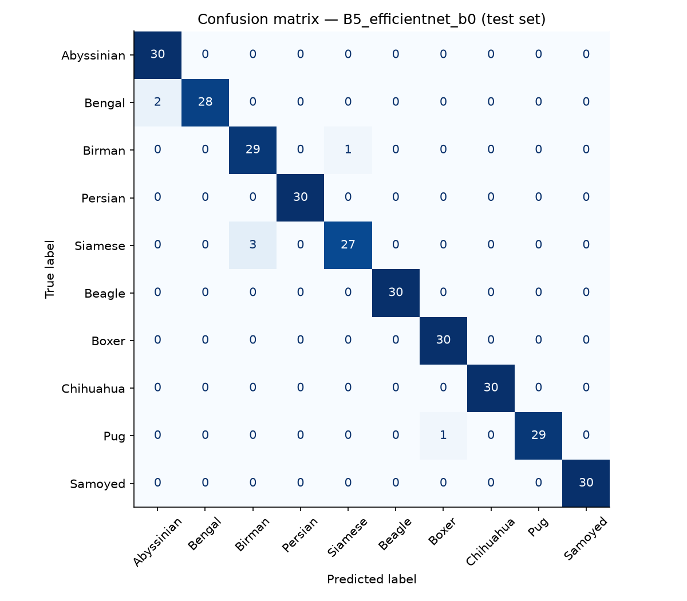
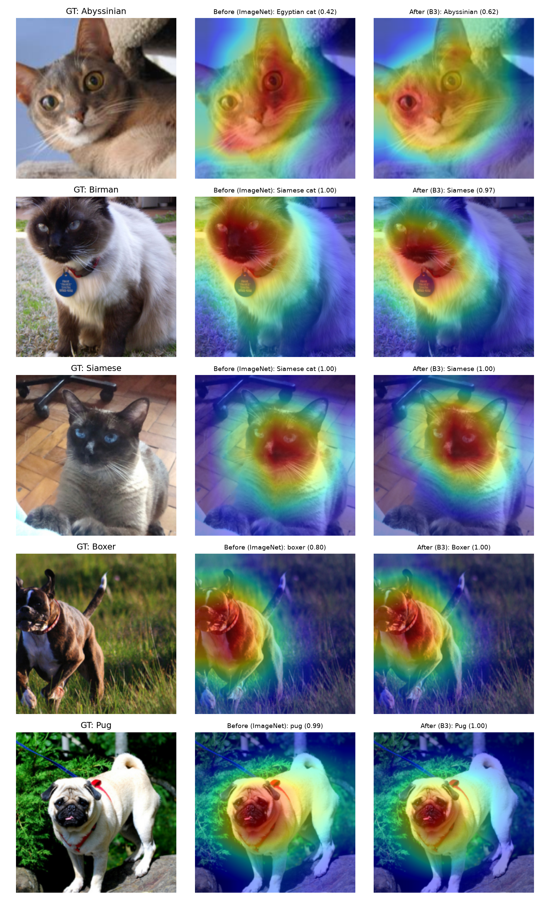

# Report
2802403183 - Brian Nicholas Tedjo

# Segmen A
### 1. Efek Regularisasi pada Batch Normalization (Slide 6–8)
#### a. Jelaskan mekanisme statistik mini-batch yang menimbulkan efek regularisasi tersebut.  

- Mini batch menjaga konsistensi aktivasi pada neural network selama proses training, sehingga distribusi input ke setiap layer tetap sama besar. Mini batch melakukan proses random untuk memilih sampel, yang kemudian akan disuntik normalisasi, yang mana mirip dengan dropout/regularisasi.

#### b. Uraikan kondisi atau skenario spesifik ketika asumsi "menghilangkan Dropout" ini
tidak lagi berlaku atau justru dapat memicu instabilitas pelatihan.

- Ukuran batch terlalu kecil, ukuran terlalu kecil membuat area perubahan jadi terlalu sempit dan jsutru membuat tidak stabil
- Layer fully-connected terlalu besar, Batch Normalization tidak cukup kuat, diperlukan dropout biasa
- Dataset kecil dengan overfit berat, efek Batch Normalization sekali lagi tidak cukup kuat

### 2. Degradasi Jaringan Dalam dan Formulasi Residual (Slide 10–12)
#### a. Mengapa penambahan kedalaman lapisan pada plain CNN (tanpa sambungan residual) justru menurunkan akurasi pelatihan (degradation problem), padahal secara teoritis
representasi model yang lebih dalam minimal dapat menyamai model dangkal via fungsi
identitas (identity mapping)?

Semakin banyak lapisan pada CNN, kemungkinan terjadinya Exploding Gradient dan Vanishing Gradient problem akan semakin meningkan. Selain itu, tanpa adanya sambungan residual, gradien yang terletak di bagian dalam neural network akan kehilangan fitur yang dibawa oleh layer-layer sebelumnya sehingga merusak representasi keseluruhan model.

#### b. Jelaskan bagaimana skip connection mengubah formulasi aliran gradien saat propagasi balik (backpropagation).

Skip connection, menggunakan persamaan $ y = F(x) + x $ untuk menghantarkan input ke layer berikutnya, memberikan kesempatan bagi layer baru untuk menerima fitur yang mirip. Hal ini membantu perhitungan gradien, mencegahnya mencapai nilai yang terlalu kecil

#### c. Hubungkan mekanisme tersebut dengan mitigasi fenomena vanishing gradient yang telah dibahas pada Sesi 02.

Skip connection membantu menghapus fenomena Vanishing Gradient secara struktural

### 3. Feature Extraction vs. Fine-Tuning (Slide 14–16)
Bandingkan pendekatan Feature Extraction (membekukan backbone) dengan Fine-
Tuning (membuka sebagian atau seluruh lapisan) ditinjau dari empat dimensi:
- Jumlah parameter yang diperbarui (trainable parameters).
- Kebutuhan volume data latih.
- Beban komputasi dan memori per epoch.
- Risiko rusaknya fitur representasi bawaan (destructive gradient updates).
Sintesiskan kriteria praktis kapan masing-masing pendekatan paling tepat dipilih.

#### Answer
| Dimensi | Feature Extraction | Fine-Tuning |
|---|---|---|
| Jumlah parameter | Hanya dilakukan pada head baru | Dilakukan pada seluruh layer |
| Kebutuhan data | Lebih rendah, karena model sudah punya representasi | Lebih tinggi, karena parameter yang harus diupdate lebih banyak. Penggunaan data yang terlalu rendah menyebabkan overfit |
| Beban komputasi | Lebih rendah | Lebih tinggi |
| Resiko rusaknya fitur bawaan | Rendah, karena bobot pretrained tidak dirubah | Lebih tinggi, karena fitur pretrained dapat tertimpa oleh gradien baru |

### 4. Kaidah Penerapan Data Augmentation (Slide 20, 21, 23)

#### a. Jelaskan pertimbangan metodologis mengapa pipeline data augmentation hanya diaktifkan pada train set dan harus dinonaktifkan pada validation/test set.

Augmentasi dilakukan untuk membuat model dapat melihat suatu input dari perspektif yang lebih beragam (invariance), untuk menghasilkan model yang lebih robust. Sedangkan pada validation dan test set, yang dibutuhkan adalah data yang sebenarnya, yakni data yang tidak dilakukan augmentasi

#### b. Berikan satu contoh teknik transformasi citra yang tidak layak digunakan untuk klasifikasi ras hewan peliharaan (pet breeds), dan jelaskan argumentasi ketidaklayakannya berdasarkan invariansi semantik label.

Transformasi warna, seperti mengubah warna menjadi hitam putih atau menggeser hue. Hal tersebut tidak tepat apabila digunakan dalam mengklasifikasikan hewan, di mana warna menjadi salah satu faktor kunci dalam membedakan spesies. Transformasi warna akan mengakibatkan perubahan warna, sehingga menghilangkan fitur penting dalam klasifikasi tersebut.

### 5. Mitigasi Catastrophic Forgetting (Slide 28–29)
Slide 28 mengingatkan potensi terjadinya catastrophic forgetting apabila proses adaptasi
model berlangsung terlalu agresif.
- Uraikan bagaimana fenomena hilangnya representasi bawaan tersebut terjadi.
- Jelaskan dua strategi mitigasi konkret (misalnya differential learning rate, gradual
unfreezing, atau linear warmup) beserta alasan teoritis mengapa strategi tersebut
efektif.

#### Answer
Catastrophic forgetting terjadi pada model yang dilakukan fine tuning yang dilakukan secara tidak tepat. Makna dari kejadian ini adalah ketika model melupakan hal yang pernah ditraining karena tertimpa oleh hasil training baru. Seringkali terjadi ketika learning rate terlalu besar, karena menghasilkan loss dan gradien besar yang segera berpengaruh kepada representasi di backbone. Faktor lain adalah data fine tuning yang terlalu kecil, mengakibatkan fitur umum yang telah ada menjadi tertimpa dan hilang

# Segmen C

### C1. Tabel Konsolidasi dan Visualisasi Pembelajaran

Seluruh angka bersumber dari `logs/summary.csv` / `logs/metrics.json` (per epoch: `logs/history.csv`). Protokol: ResNet-18 `IMAGENET1K_V1`, 224×224, batch 32, AdamW (weight decay 1e-2), CrossEntropyLoss, early stopping val loss (patience 5), seed 42; split stratified 1.397 / 299 / 300; GPU NVIDIA GeForce RTX 3080.

| Kode | Strategi | Augmentasi | Trainable / total params | Learning rate | Epoch konvergen (best / total) | Waktu latih (s) | Train acc | Val acc | Gap train-val | Test acc | Test Macro F1 | Latensi (ms/img) |
|---|---|---|---|---|---|---|---|---|---|---|---|---|
| B1 | From scratch (resnet18) | Ya | 11,181,642 / 11,181,642 | all=0.001 | 15 / 20 | 440.9 | 0.6206 | 0.5251 | +0.0955 | 0.5400 | 0.5199 | 1.50 |
| B2 | Feature extraction (resnet18) | Ya | 5,130 / 11,181,642 | head=0.001 | 25 / 30 | 665.0 | 0.9921 | 0.9465 | +0.0456 | 0.9533 | 0.9534 | 1.25 |
| B3 (= B4 dgn augmentasi) | Fine-tuning (resnet18) | Ya | 8,398,858 / 11,181,642 | last_block=0.0001, head=0.001 | 7 / 12 | 268.5 | 0.9986 | 0.9565 | +0.0420 | 0.9567 | 0.9567 | 1.44 |
| B4 tanpa augmentasi | Fine-tuning (resnet18) | Tidak | 8,398,858 / 11,181,642 | last_block=0.0001, head=0.001 | 10 / 15 | 323.2 | 1.0000 | 0.9699 | +0.0301 | 0.9633 | 0.9634 | 1.36 |
| B5 EfficientNet-B0 | Fine-tuning (efficientnet_b0) | Tidak | 1,142,202 / 4,020,358 | last_block=0.0001, head=0.001 | 7 / 12 | 261.4 | 1.0000 | 0.9866 | +0.0134 | 0.9767 | 0.9766 | 4.21 |
| B5 MobileNetV3-Small | Fine-tuning (mobilenet_v3_small) | Tidak | 951,642 / 1,528,106 | last_block=0.0001, head=0.001 | 3 / 8 | 161.9 | 0.9936 | 0.9465 | +0.0471 | 0.9700 | 0.9701 | 2.70 |

*Train acc diukur ulang pada train set tanpa augmentasi menggunakan bobot terbaik; gap = train acc − val acc. Latensi = forward pass batch 1 tanpa dataloading.*

### C2. Pembahasan Analisis Komparatif

#### 1. Disparitas performa B1 vs. B2 & B3 (Slide 10–12, 16)

> Data: Test Macro F1 B1 = 0.5199 vs. B2 = 0.9534 dan B3 = 0.9567; val loss terbaik B1 = 1.4247 vs. B2 = 0.1196 dan B3 = 0.1019.

Disparitas sangat tajam: B1 hanya mencapai test Macro F1 0.5199, sedangkan B2 dan B3 mencapai 0.9534 dan 0.9567. Kurva B1 menunjukkan train loss turun stabil (2.330 → 0.853), sehingga jaringan sebenarnya **dapat dioptimasi** — residual connection pada ResNet-18 (Slide 10–12) menjaga aliran gradien sehingga tidak terjadi *degradation problem*. Masalahnya bukan optimasi, melainkan **rasio parameter terhadap data**: 11,18 juta parameter harus dipelajari dari 1.397 citra (~140 citra per kelas), sehingga model tidak sempat membangun hierarki fitur umum (tepi → tekstur → bagian tubuh) sebelum mulai menghafal. Hal ini terlihat dari val loss B1 yang sangat fluktuatif (lonjakan ke 3.227 di epoch 8 dan 2.700 di epoch 12) — statistik BatchNorm dan fitur yang masih acak membuat prediksi validasi tidak stabil — serta gap train-val terbesar (+0.0955) walaupun train acc baru 0.62 (model sekaligus *underfit* dan *overfit*).

Sebaliknya, B2 sudah mencapai val acc 0.906 **setelah satu epoch** hanya dengan melatih 5.130 parameter. Representasi ImageNet (Slide 16) sudah memuat fitur visual tingkat tinggi yang relevan; bahkan 7 dari 10 kelas pada subset ini (Persian, Siamese, Beagle, Boxer, Chihuahua, Pug, Samoyed) merupakan kelas ImageNet-1k, sehingga ruang fitur `layer4` hampir sudah dapat dipisahkan secara linear. Transfer learning dengan demikian menggantikan kebutuhan data dalam jumlah besar dengan *prior* yang dipelajari dari 1,28 juta citra ImageNet.

#### 2. Trade-off performa vs. stabilitas: feature extraction vs. fine-tuning (Slide 16, 28)

> Data: B2 melatih 5.130 params, konvergen di epoch 25 (665.0 s); B3 melatih 8.398.858 params, konvergen di epoch 7 (268.5 s). Selisih test Macro F1 B3 − B2 = +0.0033.

Dari sisi performa, B3 hanya unggul tipis atas B2 (test Macro F1 +0.0033, setara ±1 citra dari 300) — secara praktis setara pada volume data ini. Perbedaan yang lebih nyata ada pada **dinamika pelatihan**:

- **Kecepatan konvergensi:** B3 mencapai val loss terbaik (0.1019) di epoch 7, sedangkan B2 butuh 25 epoch (0.1196). Membuka `layer4` memungkinkan fitur tingkat tinggi beradaptasi ke ciri ras (pola bulu, bentuk wajah), sehingga loss turun jauh lebih cepat.
- **Stabilitas:** kurva B2 mulus dan train/val loss nyaris berimpit sepanjang 30 epoch — dengan hanya 5.130 parameter, kapasitas model terlalu kecil untuk menghafal data. B3 mulai *overfit* setelah epoch 7: train loss terus turun ke ~0.014, sementara val loss naik kembali ke 0.162 (epoch 11) dan val acc turun ke 0.943 (epoch 12). Dengan 8,4 juta parameter terbuka (Slide 28), B3 bergantung pada early stopping untuk menghindari degradasi.
- **Biaya komputasi:** secara teori B2 jauh lebih ringan (backward hanya melalui `fc`), namun durasi per epoch semua kondisi hampir sama (B2 ≈ 22.2 s, B3 ≈ 22.4 s, B1 ≈ 22.0 s). Artinya pada skala ini pipeline dibatasi oleh *data loading* (decode JPEG + augmentasi, 2 worker), bukan oleh komputasi GPU. Total waktu B2 justru lebih lama (665.0 s vs. 268.5 s) karena membutuhkan lebih banyak epoch.

Kesimpulannya: feature extraction menawarkan stabilitas dan risiko overfitting yang rendah, sedangkan fine-tuning bertahap menawarkan konvergensi lebih cepat dan sedikit peningkatan akurasi dengan syarat learning rate kecil pada backbone (1e-4) dan early stopping yang ketat.

#### 3. Peran augmentasi dalam meredam overfitting (Slide 20)

> Data: gap train-val dengan augmentasi (B3) = +0.0420, tanpa augmentasi (B4) = +0.0301; test Macro F1 B3 = 0.9567, B4 = 0.9634.

Pada eksperimen ini augmentasi **tidak** meredam overfitting: gap train-val justru lebih kecil tanpa augmentasi (B4: +0.0301) dibanding dengan augmentasi (B3: +0.0420), dan B4 juga sedikit lebih baik pada val acc (0.9699 vs. 0.9565) maupun test Macro F1 (0.9634 vs. 0.9567). Selisih test F1 sebesar 0.0067 hanya setara ±2 citra, sehingga masih dalam rentang variasi run tunggal (single seed); hasil yang dapat disimpulkan adalah bahwa augmentasi **tidak memberikan manfaat terukur** pada konfigurasi ini, bukan bahwa augmentasi merugikan.

Beberapa penjelasan yang konsisten dengan data:

1. **Overfitting B4 bersifat "jinak".** B4 mencapai train acc 1.000 sejak epoch 3 (train loss 0.001), namun val loss tetap datar di 0.094–0.103 hingga epoch 15. Karena backbone pretrained dibekukan kecuali `layer4` dan lr backbone kecil, model menghafal data latih tanpa merusak fitur umum — sehingga regularisasi tambahan dari augmentasi tidak banyak berperan.
2. **Augmentasi mengganggu ciri pembeda yang halus.** Klasifikasi ras adalah tugas *fine-grained*; `ColorJitter` (brightness/contrast 0.2) mengubah nada warna yang justru menjadi pembeda utama (misalnya warna *ruddy* Abyssinian vs. Bengal, atau titik warna Siamese vs. Birman), sedangkan `RandomResizedCrop` dapat memotong ciri seperti kaki putih Birman — kelas-kelas yang muncul pada failure analysis (C3).
3. **Pelatihan terlalu singkat untuk memetik manfaat augmentasi.** B3 berhenti pada epoch terbaik 7; augmentasi biasanya membutuhkan lebih banyak epoch karena setiap epoch menampilkan variasi data yang berbeda (Slide 20).

### C3. Failure Analysis (Analisis Kasus Misklasifikasi)

Model terbaik (dipilih berdasarkan val acc): **B5 EfficientNet-B0** — 7 dari 300 citra test salah diprediksi (test Macro F1 = 0.9766). Sumber: `logs/misclassified_best.csv`.

| # | File | GT → Pred (conf.) | Hipotesis |
|---|---|---|---|
| 1 | `Siamese_257.jpg` | Siamese → Birman (0.97) | **Ambiguitas antar ras + usia.** Anak kucing berbulu tebal/halus; pola *colorpoint* belum gelap sehingga mirip Birman (berbulu semi-panjang). Citra buram, beresolusi rendah, dan ada efek *red-eye* dari flash. |
| 2 | `Birman_57.jpg` | Birman → Siamese (0.95) | **Ciri pembeda tidak terlihat.** Ciri khas Birman (kaki putih / *white gloves*) tidak tampak: kaki depan gelap/terpotong di bagian bawah frame; topeng wajah gelap yang kuat lebih mirip Siamese. Kalung + *tag* juga menutupi area dada. |
| 3 | `pug_74.jpg` | Pug → Boxer (0.85) | **Morfologi atipikal / kemungkinan label noise.** Moncong lebih panjang dan kaki lebih tinggi dari pug pada umumnya (menyerupai *puggle*/campuran) dengan warna fawn khas Boxer; pose duduk tegak di kursi lipat juga jarang di data latih. |
| 4 | `Siamese_185.jpg` | Siamese → Birman (0.79) | **Ambiguitas antar ras (anak kucing) + bias latar.** Anak kucing dengan bulu halus menyerupai Birman muda; objek kecil di tengah, latar (keranjang, motif hati, tirai hijau) mendominasi frame. |
| 5 | `Siamese_183.jpg` | Siamese → Birman (0.69) | **Crop terlalu dekat (close-up wajah).** Hanya wajah yang terlihat; panjang bulu tubuh dan warna kaki — satu-satunya pembeda Siamese vs. Birman (keduanya *colorpoint* bermata biru) — tidak ada di citra. |
| 6 | `Bengal_100.jpg` | Bengal → Abyssinian (0.67) | **Sudut ekstrem + pola bulu atipikal.** Diambil dari atas (*top-down*); pola bulu tampak seperti garis tabby biasa, bukan *rosette/spot* khas Bengal; warna jingga hangat menyerupai bulu *ruddy* Abyssinian. |
| 7 | `Bengal_143.jpg` | Bengal → Abyssinian (0.58) | **Kualitas citra buruk.** Citra buram, kontras rendah, close-up dengan mata menyipit; pola bulu yang memudar terbaca seperti bulu *ticked* Abyssinian. Confidence rendah (0.58 vs. 0.42 untuk Bengal) menunjukkan model ragu di antara keduanya. |

### C4. Rekomendasi Rekayasa dan Batasan Eksperimen

> Data: B5 EfficientNet-B0 — test Macro F1 0.9766, 4.020.358 params, 261.4 s latih, 4.21 ms/img; B5 MobileNetV3-Small — 0.9701, 1.528.106 params, 161.9 s, 2.70 ms/img; B4 ResNet-18 — 0.9634, 11.181.642 params, 323.2 s, 1.36 ms/img.
> Konteks studi: single seed (42), satu kali run per kondisi, 10 dari 37 kelas, 1.397 citra latih, GPU RTX 3080 (bukan T4).

**Rekomendasi untuk skenario data terbatas (~140 citra/kelas):**

1. **Jangan melatih dari nol.** B1 tertinggal >0.43 poin Macro F1 dari semua kondisi transfer learning dengan waktu latih yang sebanding; tidak ada alasan praktis memilih strategi ini pada volume data ini.
2. **Strategi default: fine-tuning blok terakhir dengan differential learning rate** (backbone 1e-4, head 1e-3) + early stopping pada val loss (patience 3–5). Strategi ini konvergen paling cepat (7–10 epoch) dan menghasilkan akurasi terbaik pada ketiga arsitektur.
3. **Pilihan arsitektur bergantung pada constraint operasional:**
   - **Akurasi maksimum:** EfficientNet-B0 (test Macro F1 0.9766, 4,0 juta params, checkpoint ±16 MB), dengan latensi GPU batch-1 tertinggi (4.21 ms/citra).
   - **Latensi GPU terendah:** ResNet-18 (1.36 ms/citra, F1 0.9634) — meskipun parameternya terbanyak (11,2 juta), operasi konvolusi standar lebih efisien di GPU dibanding *depthwise convolution* + *squeeze-and-excitation* pada EfficientNet. Jumlah parameter bukan prediktor latensi yang baik.
   - **Memori/penyimpanan terbatas (edge/mobile):** MobileNetV3-Small (1,5 juta params, checkpoint ±6 MB, F1 0.9701) dengan waktu latih tercepat (161.9 s). Latensi CPU/mobile belum diukur pada studi ini dan harus diverifikasi pada perangkat target.
4. **Feature extraction (B2) layak dipilih** bila memori GPU sangat terbatas, data per kelas jauh lebih sedikit, atau satu backbone harus dipakai bersama oleh banyak tugas. Karena backbone beku, embedding dapat dihitung **sekali** lalu di-cache, sehingga pelatihan head menjadi hampir instan — mengatasi bottleneck data loading yang teramati (±22 s/epoch).
5. **Augmentasi harus divalidasi, bukan diterapkan secara default.** Untuk tugas fine-grained berbasis warna/pola bulu, pertimbangkan augmentasi geometris ringan saja (flip, crop) tanpa color jitter, dan bandingkan pada validation set.
6. **Gunakan ambang confidence untuk produksi.** 4 dari 7 kesalahan model terbaik memiliki confidence < 0.80, dan pada semua kasus kelas benar adalah pilihan ke-2. Prediksi dengan confidence rendah sebaiknya dialihkan ke peninjauan manusia; nilai ambang perlu dikalibrasi pada validation set.

**Batasan eksperimen:**

- **Single seed, satu run per kondisi.** Dengan val/test set ±300 citra, satu citra = 0.33 poin persentase; perbedaan antara B2, B3, B4, dan B5 (0.3–2.3 poin) berada pada orde yang sama dengan variasi antar-seed, sehingga peringkat di antara kondisi tersebut belum dapat dianggap signifikan. Contohnya, MobileNetV3-Small memiliki val acc 0.9465 tetapi test acc 0.9700 — indikasi varians evaluasi yang besar.
- **Domain sangat dekat dengan ImageNet.** 7 dari 10 kelas merupakan kelas ImageNet-1k, sehingga manfaat transfer learning di sini bersifat optimistis; pada domain yang jauh (citra medis, satelit) fine-tuning yang lebih dalam kemungkinan lebih diperlukan.
- **Cakupan terbatas:** 10 dari 37 kelas, ±140 citra latih per kelas; satu set augmentasi yang diuji hanya pada B3; tanpa learning-rate scheduler maupun warmup.
- **B5 tidak di-tuning per arsitektur.** Konfigurasi (lr, blok yang dibuka) diambil dari hasil ResNet-18; "blok terakhir" EfficientNet/MobileNet didefinisikan sebagai dua tahap `features` terakhir sehingga tidak sepenuhnya setara dengan `layer4`.
- **Lingkungan komputasi:** dijalankan pada NVIDIA GeForce RTX 3080 (bukan T4 Colab); latensi diukur pada GPU dengan batch 1, dan waktu latih dipengaruhi bottleneck data loading.

### C5. Eksplorasi Tambahan: Grad-CAM `layer4` Sebelum vs. Sesudah Fine-Tuning

Grad-CAM pada `layer4` dibandingkan antara ResNet-18 ImageNet asli (target: kelas ImageNet top-1) dan model B3 setelah fine-tuning (target: kelas pet prediksi):

- **Pergeseran bersifat penajaman, bukan relokasi.** Pada sebagian besar sampel, area aktivasi sebelum dan sesudah fine-tuning tetap berada pada kepala/wajah hewan. Hal ini sesuai dengan best practice Slide 29: learning rate kecil (1e-4) pada `layer4` mempertahankan representasi pretrained (mencegah *catastrophic forgetting*) dan hanya menyesuaikannya secara halus ke domain ras.
- **Fokus lebih sempit pada ciri ras.** Pada sampel Pug, peta aktivasi sebelum fine-tuning menyebar ke tubuh dan latar semak; setelah fine-tuning aktivasi terkonsentrasi pada wajah berkerut dan topeng hitam, dengan atensi pada latar berkurang. Pada Abyssinian, fokus bergeser dari moncong ke area mata/wajah.
- **Confidence meningkat untuk kelas baru.** Abyssinian bukan kelas ImageNet; model asli memprediksi "Egyptian cat" (0.42), sedangkan model B3 memprediksi Abyssinian dengan benar (0.62). Untuk kelas yang sudah ada di ImageNet, confidence naik ke ~1.00 (Boxer 0.80 → 1.00, Pug 0.99 → 1.00).
- **Bias yang diwarisi tetap ada.** Sampel Birman (`Birman_57.jpg`) diprediksi "Siamese cat" (1.00) oleh model ImageNet dan tetap "Siamese" (0.97) oleh B3 — kesalahan yang sama juga dibuat model terbaik (C3). Aktivasi terpusat pada topeng wajah gelap, ciri yang sama-sama dimiliki Siamese, bukan pada kaki putih yang membedakan Birman. Karena Birman tidak ada di ImageNet sementara Siamese ada, fine-tuning ringan pada `layer4` belum cukup menggeser atensi ke ciri pembeda tersebut; membuka `layer3` atau augmentasi yang mempertahankan bagian kaki dapat menjadi eksplorasi lanjutan.

# Referensi

- He, K., Zhang, X., Ren, S., & Sun, J. (2016). Deep Residual Learning for Image Recognition. *CVPR*.
- Ioffe, S., & Szegedy, C. (2015). Batch Normalization: Accelerating Deep Network Training by Reducing Internal Covariate Shift. *ICML*.
- Tan, M., & Le, Q. (2019). EfficientNet: Rethinking Model Scaling for Convolutional Neural Networks. *ICML*.
- Howard, A., et al. (2019). Searching for MobileNetV3. *ICCV*.
- Selvaraju, R. R., et al. (2017). Grad-CAM: Visual Explanations from Deep Networks via Gradient-based Localization. *ICCV*.
- Parkhi, O. M., Vedaldi, A., Zisserman, A., & Jawahar, C. V. (2012). Cats and Dogs. *CVPR*.
- Bahan tayang Sesi 05 — *Advanced CNNs and Transfer Learning*.

# Lampiran: Pernyataan Penggunaan AI (AI Disclosure Statement)

- **Model/alat AI:** Claude (Anthropic), melalui Claude Code.
- **Ruang lingkup bantuan:** menyusun kode `answer.ipynb` (pipeline data, eksperimen B1–B5, logging, visualisasi, Grad-CAM) berdasarkan starter code tugas; menjalankan uji coba singkat (smoke test) notebook; menyusun `README.md`, `requirements.txt`, serta kerangka dan tabel data laporan ini dari berkas log.
- **Verifikasi mandiri:** membaca tiap baris, memverifikasi jumlah trainable parameters 5.130 untuk B2, mencocokkan angka laporan dengan `logs/summary.csv`, meninjau ulang setiap citra misklasifikasi.
- Bagian A ditulis sendiri oleh mahasiswa. Draf C2–C5 dari AI telah ditulis ulang, diverifikasi terhadap `logs/` dan `figures/`, dan disunting oleh mahasiswa.
